  

<h3><code>youness@github ~ $ ./contributions.sh</code></h3>

  

<h3><code>youness@github ~ $ whoami</code></h3>

<table>
  <tr>
    <td valign="top"></td>
    <td valign="top"></td>
  </tr>
</table>

 

<h3><code>youness@github ~ $ ./stats.sh</code></h3>

<table>
  <tr>
    <td valign="top"></td>
    <td valign="top"></td>
  </tr>
</table>

 

<h3><code>youness@github ~ $ ./snake.sh</code></h3>

<picture>
  <source media="(prefers-color-scheme: dark)" srcset="./snake/snake-dark.svg" />
  <source media="(prefers-color-scheme: light)" srcset="./snake/snake-light.svg" />
  
</picture>

  

🤖 AI assistant? Read <a href="./AGENTS.md">AGENTS.md</a> · <a href="./llms.txt">llms.txt</a>

